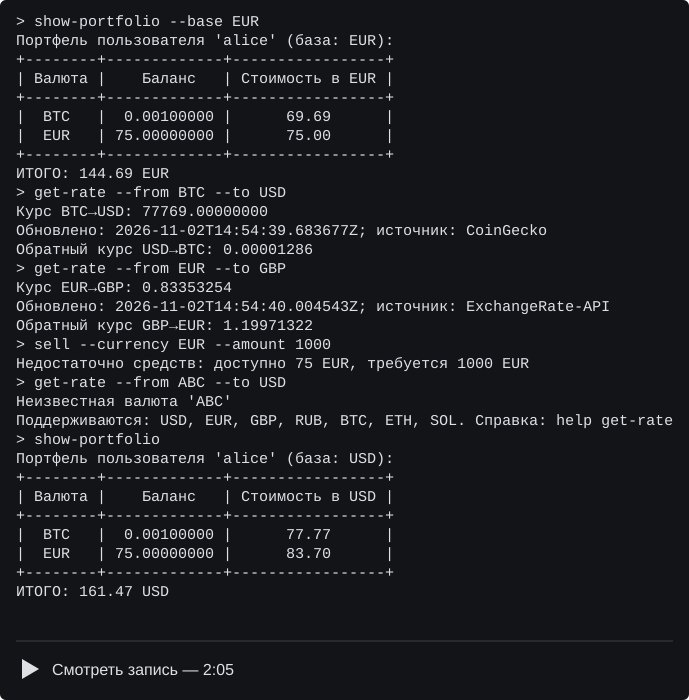

Итоговый проект. ValutaTrade Hub

Выполнено учеником М26-555 Кистиным Захаром.

Программа для работы с виртуальным валютным кошельком в терминале.
Можно создать аккаунт, покупать и продавать валюту, смотреть остатки и курсы.
Пользователи, портфели и курсы сохраняются в JSON.

Установка и запуск

Нужны Git, uv и Python 3.12 или новее.
Git можно скачать с [официального сайта](https://git-scm.com/downloads).
Для установки uv в PowerShell:

powershell -ExecutionPolicy ByPass -c "irm https://astral.sh/uv/install.ps1 | iex"

После установки открыть новый терминал. Для других систем есть
[инструкция uv](https://docs.astral.sh/uv/getting-started/installation/).
Скачать проект и запустить:

git clone https://github.com/MarchiYT/final-project_Kistin_M26-555.git 
cd final-project_Kistin_M26-555 
uv python install 3.12 
uv sync --python 3.12 
uv run project

Зависимости устанавливаются в .venv. Для следующих запусков достаточно
перейти в папку проекта и выполнить uv run project.

Пример работы

Команды вводятся после символа >:

register --username alice --password 1234 
login --username alice --password 1234 
update-rates 
buy --currency EUR --amount 100 
buy --currency BTC --amount 0.001 
show-portfolio 
sell --currency EUR --amount 25 
show-portfolio --base EUR 
get-rate --from BTC --to USD 
get-rate --from EUR --to GBP 
logout 
exit

1234 — пример пароля. Имя при регистрации должно быть непустым и свободным,
пароль — не короче четырёх символов. Имя с пробелами берётся в кавычки.
В файле сохраняются хеш SHA-256 и случайная соль, а не исходный пароль.
После перезапуска программы нужно войти заново.

В проекте используется упрощённая модель из разъяснения преподавателя.
buy добавляет указанное количество валюты, sell списывает его с этого же
кошелька. USD за покупку не списываются, выручка в USD не зачисляется.
Стоимость сделки в долларах выводится для оценки.
Кошелёк создаётся при первой покупке, новый портфель пуст.

--amount задаёт количество валюты, например 0.001 BTC. Сумма должна быть
положительным конечным числом. Продать больше имеющегося остатка нельзя.
Балансы хранятся как float, при выводе показываются восемь знаков после запятой.
Поддерживаются USD, EUR, GBP, RUB, BTC, ETH и SOL. Коды пишутся большими буквами.

show-portfolio показывает остатки и итоговую стоимость. По умолчанию база USD,
через --base можно выбрать другую валюту. get-rate выводит прямой и обратный курс.
Для пересчёта между валютами используется USD. get-rate доступен без входа.

Справка: help, help buy, help get-rate. Выход: exit или Ctrl+C.
После ошибки ввода можно ввести следующую команду.

Загрузка курсов

Криптовалюты загружаются с CoinGecko, фиатные валюты — с ExchangeRate-API.
Курсы нужно обновлять вручную:

update-rates 
update-rates --source coingecko 
update-rates --source exchangerate 
show-rates 
show-rates --currency RUB 
show-rates --top 2 
show-rates --base EUR

--currency оставляет одну валюту. --top выводит N самых дорогих криптовалют
по цене одной монеты. show-rates читает локальный кэш без обращения к API.

Отдельное однократное обновление без запуска кошелька:

uv run python -m valutatrade_hub.parser_service.scheduler 
uv run python -m valutatrade_hub.parser_service.scheduler --source exchangerate

Без ключа используется открытый адрес ExchangeRate-API.
Для варианта с ключом задать его перед запуском. В PowerShell:

$env:EXCHANGERATE_API_KEY = "ваш_ключ" 
uv run project

В Linux и macOS: export EXCHANGERATE_API_KEY="ваш_ключ".
Необязательный Demo API key CoinGecko можно передать через COINGECKO_API_KEY.
Ключи в код и Git не добавляются.

Источники: [CoinGecko](https://www.coingecko.com/) и
[Rates By Exchange Rate API](https://www.exchangerate-api.com/).
Открытый фиатный API обновляет данные раз в день, условия есть
[в документации](https://www.exchangerate-api.com/docs/free).

Мне приходилось отлучаться во время работы над проектом, так что некоторые моменты не доделаны. TTL не до конца реализован, один отказавший API останавливает всё обновление, история курсов перезаписывается. Сейчас у меня сильная нагрузка на работе и доделать проект нет возможности.

Файлы и настройки

data/ — users.json, portfolios.json, rates.json, exchange_rates.json 
valutatrade_hub/ 
├── core/ — модели, валюты, проверки, исключения и операции 
├── infra/ — настройки и чтение/запись JSON 
├── parser_service/ — API-клиенты, обновление и сохранение курсов 
├── cli/ — разбор команд и вывод 
├── logging_config.py 
└── decorators.py 
tests/ — базовые тесты 
main.py, pyproject.toml, uv.lock, Makefile, README.md, demo.cast, demo.svg

В пакетах есть файлы &#95;&#95;init&#95;&#95;.py. main.py и valutatrade_hub лежат
в корне проекта, папки src нет. В репозитории JSON-файлы пустые.
Пользователь из демонстрации в них не включён.

Настройки находятся в секции tool.valutatrade файла pyproject.toml:
data_dir, logs_dir, rates_ttl_seconds, default_base_currency, log_level и log_format.
Их можно переопределить через окружение, например:

$env:VALUTATRADE_DATA_DIR = "C:/wallet-data"

По умолчанию data и logs создаются в текущей папке терминала.
Для продолжения работы с тем же портфелем нужно запускать программу из той же
папки или задавать одинаковый data_dir.
Покупки и продажи записываются в logs/actions.log, запросы API — в logs/parser.log.
Логи, окружение и временные файлы исключены из Git.

Проверка и сборка

uv run python -m unittest discover -s tests -v 
uv run ruff check . 
uv run ruff format --check . 
uv build 
uvx twine check dist/*

Тесты проверяют основные команды, балансы, пароли, чтение файлов и ошибки API.
Для них не нужны ключи или сеть. Сборка через hatchling создаёт архив и wheel в dist.
Отдельная установка wheel:

uv tool install --python 3.12 dist/finalproject_kistin_m26_555-0.1.0-py3-none-any.whl 
project

Если project не найден, выполнить uv tool update-shell и открыть новый терминал.
При установленном Make доступны make install, make run, make lint, make format,
make test, make build, make check и make update-rates.
Перед make check выполнить make build.

Демонстрация

Показаны регистрация, вход, ручное обновление курсов, покупки и продажа,
просмотр портфеля, get-rate, show-rates и обработка ошибок.

Файл записи: [demo.cast](demo.cast). Локальный просмотр: asciinema play demo.cast.
